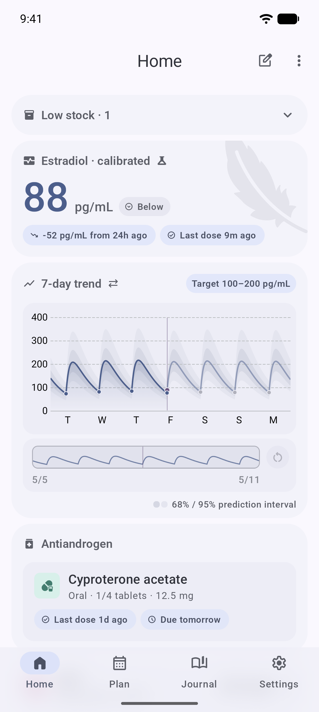
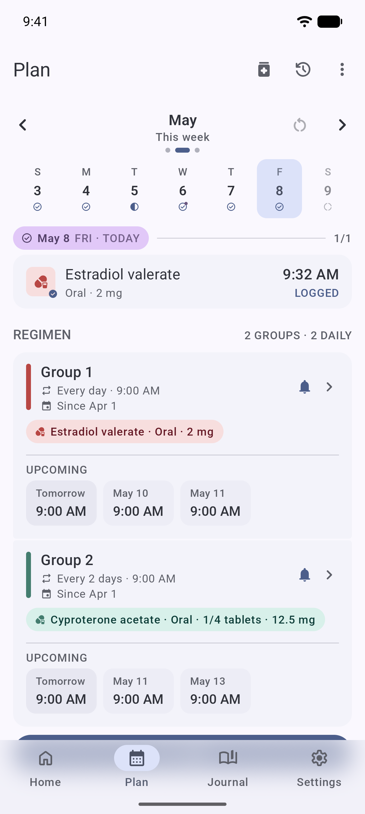
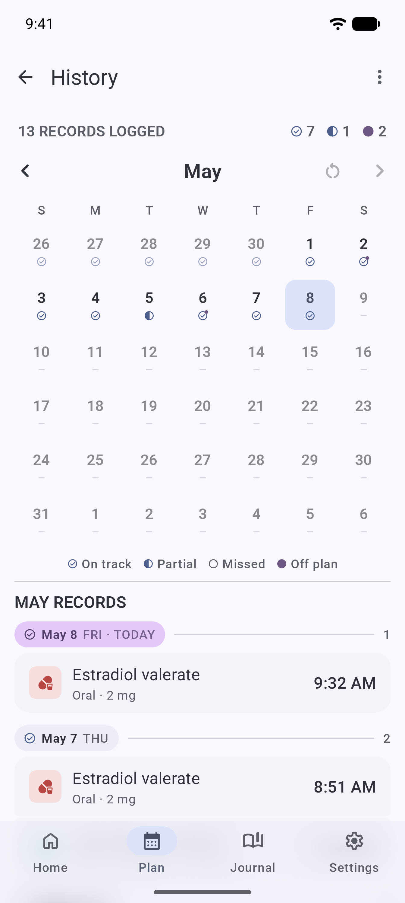
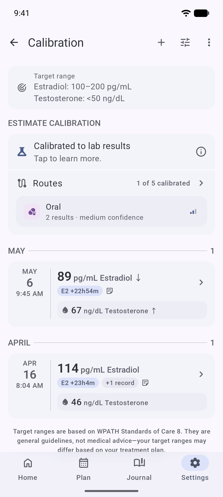

  

# Featherline

[English](README.md) · [简体中文](README.zh-Hans.md) · [繁體中文](README.zh-Hant.md) · **廣東話**

專為 Android 打造嘅 HRT 用藥記錄應用，設有 PK 藥代動力學曲線推算同血液檢查追蹤功能。數據全部儲存於本機並加密，唔需要帳戶。

Featherline 可以記錄注射、貼片、凝膠、口服同舌下五種用藥途徑嘅劑量；利用三室藥代動力學模型，按你用藥記錄推算雌二醇水平；仲可以追蹤血液檢查結果，並自動換算標準單位同臨床單位。所有數據都儲存於加密嘅本機資料庫——唔需要帳戶、唔會收集遙測數據、唔會發動任何網絡連線。備份檔案會經過加密同壓縮。介面提供英文、簡體中文、繁體中文同廣東話。

> ⚠️ **唔係醫療建議。** Featherline 只係一個記錄工具，並非醫療儀器，使用本應用亦唔會構成醫患關係。藥代動力學曲線只係根據你記錄嘅劑量做出嘅粗略人群平均估算，並可選擇按用藥途徑對齊你自己嘅雌二醇檢查結果——但佢並不能取代驗血，亦都不能取代醫生嘅判斷，請勿據此調整用藥。如遇緊急情況，請即 Call 999。完整免責聲明請參閱 [docs/safety.md](docs/safety.md)。

## 下載應用

- **Play Store**：[連結](https://play.google.com/store/apps/details?id=com.mkx.hrttracker)
- **F-Droid**：[連結](https://f-droid.org/packages/com.mkx.hrttracker)
- **GitHub Releases**（已簽名 APK，可作側載安裝）：[releases 頁面](https://github.com/mkx173/Featherline/releases)
- 或者從源碼建置：請參閱 [docs/building.md](docs/building.md)

> **注意：** 建議使用 Play Store 或 F-Droid 版本。本應用冇申請網絡權限，所以 GitHub 嘅 APK 冇辦法自動檢查更新——有新版本時要自己手動睇住 releases 頁面。

## 功能

- 記錄注射、貼片、凝膠、口服同舌下五種用藥途徑嘅劑量
- 可自訂提醒時間表，支援稍後提醒同精確鬧鐘處理
- 將藥物分組，並對組內劑量套用時間表
- 可選用藥物庫存追蹤，提供庫存不足警告，以及配合時間表計算嘅「剩餘天數」估算
- 按用藥記錄推算雌二醇藥代動力學曲線
- 估算校準：按用藥途徑將雌二醇推算曲線對齊你自己嘅 E2 檢查結果，附有各途徑信心度、異常結果覆核清單，以及主頁圖表上嘅預測區間
- 血液檢查項目目錄，自動換算單位（pg/mL ↔ pmol/L、ng/dL ↔ nmol/L）
- 加密、壓縮嘅備份格式，附完整還原驗證
- 應用鎖，支援生物識別解鎖
- 主屏幕快速記錄小工具，提供兩種大小，顯示進度、下一次用藥時間，兼可點擊記錄
- 日記分頁：以時間線記錄重要日子同里程碑，亦可寫每日筆記；任何日期都可以固定到主屏幕，變成顯示累計日數嘅時間線小工具或快捷方式
- 唔需要帳戶、唔會收集遙測數據、唔會發動網絡連線——所有數據都留喺裝置上
- 英文、簡體中文、繁體中文同香港粵語介面
- Material 3 動態取色

## 屏幕截圖

<table>
  <tr>
    <td width="25%"></td>
    <td width="25%"></td>
    <td width="25%"></td>
    <td width="25%"></td>
  </tr>
  <tr>
    <td align="center">主頁</td>
    <td align="center">計劃</td>
    <td align="center">歷史</td>
    <td align="center">校準</td>
  </tr>
</table>

## 運作原理

Featherline 係一個以 Kotlin 同 Jetpack Compose 編寫嘅單一模組 Android 應用。劑量、提醒同檢查結果都儲存於經 SQLCipher 加密嘅 Room 資料庫。藥代動力學引擎採用三室模型，將每筆記錄嘅劑量隨時間轉化成相應嘅雌二醇貢獻，再將所有用藥途徑嘅貢獻加總，得出推算曲線。當你記錄 E2 檢查結果時，裝置內建嘅擬合程式會按各途徑縮放貢獻值去貼近結果，並喺調整後嘅曲線周圍繪出預測區間。提醒功能使用 AlarmManager，具備精確鬧鐘權限處理同稍後提醒支援；通過核對層，通知喺裝置重啟同時間更改後依然準確。血液檢查目錄以標準因子表為各分析項目定義雙向單位轉換。備份檔案經過加密、壓縮，並採用帶版本號嘅格式，附完整嘅還原驗證。

完整嘅架構、資料模型同提醒流程請參閱 [docs/architecture.md](docs/architecture.md)。

## 路線圖

- 以更通用嘅多藥物模型取代現有藥代動力學引擎
- 可選嘅加密雲端備份（預設關閉，端對端加密）
- 更多語言——歡迎喺 [Hosted Weblate](https://hosted.weblate.org/projects/featherline/) 參與翻譯（請參閱 [docs/localization.md](docs/localization.md)）

## 技術棧

Kotlin、Jetpack Compose（Material 3）、Hilt 依賴注入、Room 配 SQLCipher 加密儲存、Coroutines + Flow。確切版本號請參閱 [gradle/libs.versions.toml](gradle/libs.versions.toml)。

## 從源碼建置

系統需求：JDK 17、較新版本嘅 Android Studio，以及 API 級別同項目 `compileSdk` 相符嘅 Android SDK。按 Android Studio 標準流程匯入項目，執行 `./gradlew assembleDebug`，或者直接喺 IDE 建置。

詳細說明、建置變體同 CI 行為：請參閱 [docs/building.md](docs/building.md)。

## 貢獻

歡迎貢獻。請先閱讀 [行為守則](CODE_OF_CONDUCT.md)，然後參閱 [CONTRIBUTING.md](CONTRIBUTING.md) 了解開發流程、分支慣例同提出改動嘅方式。

歡迎喺 [Hosted Weblate](https://hosted.weblate.org/projects/featherline/) 參與翻譯。

## 私隱

Featherline 將所有數據以加密形式儲存於你嘅裝置上，冇帳戶、冇遙測、冇網絡連線。完整嘅數據處理說明請參閱 [docs/privacy.md](docs/privacy.md)。

## 授權條款

Featherline 以 GNU 通用公眾授權條款 3.0 版（GPL v3）發布。完整條文請參閱 [LICENSE](LICENSE)。
第三方套件、素材同改寫代碼嘅聲明，請參閱 [docs/third-party-notices.md](docs/third-party-notices.md)。

## 致謝

- [Material Symbols](https://fonts.google.com/icons) 圖示集。
- 藥代動力學推算參考咗 [HRT-Recorder-PKcomponent-Test](https://github.com/LaoZhong-Mihari/HRT-Recorder-PKcomponent-Test) 嘅數學參考。
- 十一酸雌二醇嘅藥代動力學參數來自 [Transmtf-HRT-Tracker](https://github.com/TransmtfTeam/Transmtf-HRT-Tracker)。
- 圖表顯示邏輯改編自 [Oyama's HRT Tracker](https://github.com/SmirnovaOyama/Oyama-s-HRT-Tracker)。
- 跨性別健康社群——多謝佢哋嘅測試、回饋同先行研究，令呢類工具得以實現。
