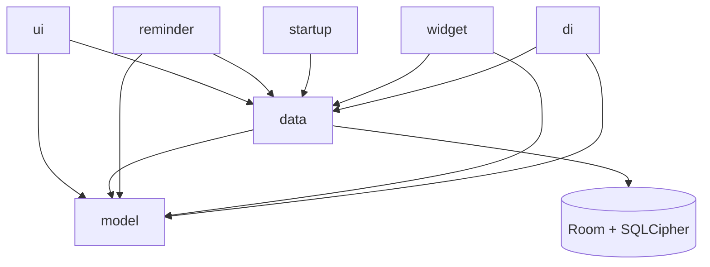
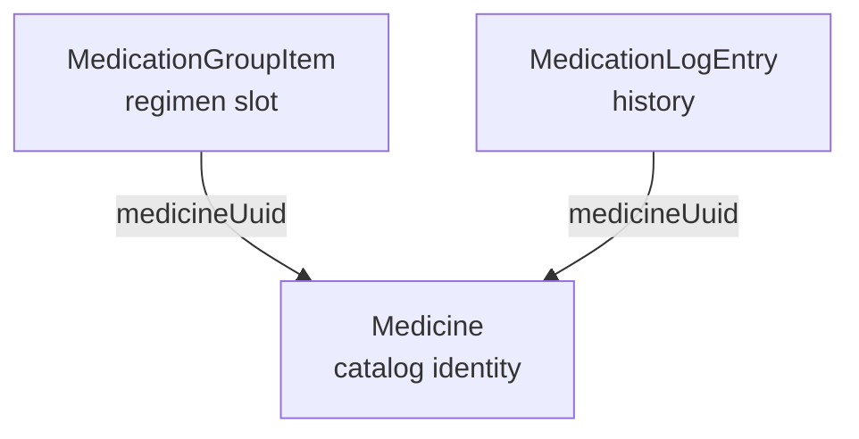

# Architecture

This page is the structural overview of the Featherline codebase: where
the layers sit, what each top-level package owns, how dependency
injection and navigation are wired, and one representative read path
through every layer. Use it together with [data-model.md](data-model.md)
to get oriented before reading individual feature pages.

## Layer map

The rules:

- `model` is pure Kotlin, no Android dependencies. Domain types and
  pure functions only.
- `data` wraps Room, DataStore, and the encrypted backup codec; it
  depends on `model` types.
- `ui` is Compose; it depends on both `model` and `data` through
  ViewModels.
- `reminder` (AlarmManager), `startup` (Hilt-eager preloader), and
  `widget` (Glance home-screen widget) are sibling top-level packages
  that bypass `ui` and read directly from `data`.

## Top-level packages

Everything lives under `com.mkx.hrttracker`. The top-level packages
are organized by role:

- [`model`](https://github.com/mkx173/Featherline/tree/main/app/src/main/java/com/mkx/hrttracker/model) — pure-Kotlin domain.
  Seven sub-packages, including `model/journal` for pure journal date
  and note logic.
- [`data`](https://github.com/mkx173/Featherline/tree/main/app/src/main/java/com/mkx/hrttracker/data) — Room, DataStore, backup
  codec, and external-import plumbing. Four sub-packages:
  `backup`, `importer`, `local`, and `repository`. `data/repository`
  holds 12 `*Repository` classes plus the Home cache stores, the
  `E2Derivation` estimate functions, the
  `MedicationEntityMappers`, `MedicineEntityMappers`, and
  `JournalEntityMappers` helpers, plus the stock-projection helpers
  (see below). `JournalRepository` owns the phase-1 journal
  tracked-date and daily-note data surface.
- [`ui`](https://github.com/mkx173/Featherline/tree/8e46ab59d3328a389c20e588bd1e62174dcb8b19/app/src/main/java/com/mkx/hrttracker/ui) — Compose UI. Eleven feature
  sub-packages plus `components`, `navigation`, `theme`.
- [`di`](https://github.com/mkx173/Featherline/tree/8e46ab59d3328a389c20e588bd1e62174dcb8b19/app/src/main/java/com/mkx/hrttracker/di) — Hilt modules. Two files.
- [`reminder`](https://github.com/mkx173/Featherline/tree/8e46ab59d3328a389c20e588bd1e62174dcb8b19/app/src/main/java/com/mkx/hrttracker/reminder) — AlarmManager pipeline,
  capability reconciliation, notification text and channels. 18 files;
  documented in detail in [reminders.md](reminders.md).
- [`startup`](https://github.com/mkx173/Featherline/tree/8e46ab59d3328a389c20e588bd1e62174dcb8b19/app/src/main/java/com/mkx/hrttracker/startup) — Hilt-eager startup
  preloader and timing instrumentation. Two files.
- [`util`](https://github.com/mkx173/Featherline/tree/8e46ab59d3328a389c20e588bd1e62174dcb8b19/app/src/main/java/com/mkx/hrttracker/util) — app-wide helpers
  (formatters, lock manager, time source, diagnostics, toast). Not a
  catch-all "lib"; entries earn their place by being used in two or
  more features.
- [`widget`](https://github.com/mkx173/Featherline/tree/642ffa739a76211a3e9dd422d66f329296055bf2/app/src/main/java/com/mkx/hrttracker/widget) — the home-screen Glance
  widget: snapshot builder, encrypted DataStore, three `GlanceAppWidget`
  surfaces (two dose widgets plus the journal-driven anchor widget and
  its pinned-shortcut manager), the periodic refresh worker, and the
  quick-log `ActionCallback`. Documented in detail in [widget.md](widget.md).

Two files sit at the package root, outside any sub-package:
[`HrtTrackerApplication.kt`](https://github.com/mkx173/Featherline/blob/main/app/src/main/java/com/mkx/hrttracker/HrtTrackerApplication.kt)
(the Hilt `@HiltAndroidApp` entry point) and
[`MainActivity.kt`](https://github.com/mkx173/Featherline/blob/main/app/src/main/java/com/mkx/hrttracker/MainActivity.kt)
(the single Activity that hosts `HrtTrackerNavHost`).

## Catalog, regimen, and history

Pharmaceutical state is split three ways. Reading the codebase out of
order without this split in mind will conflate types that mean very
different things:

- **Catalog** — `Medicine` is the identity of "what you take": the
  drug plus its preparation (a 2 mg estradiol valerate tablet, a
  20 mg/ml multi-use vial, a 50 mcg/day patch). It is content-addressed
  by `MedicineIdentityKey` so duplicates collapse; editing a slot's
  preparation either finds the existing matching medicine or creates a
  new one, leaving the old `Medicine` row in place so any historical
  log entry that referenced it stays attributable to what was actually
  taken. Lives in `model/medication/` next to the regimen types;
  managed via the `ui/catalog` Compose package.
- **Regimen** — `MedicationGroup` plus its slots is the plan: "take
  this medicine at these times, on these days." Each slot references a
  medicine by `medicineUuid` rather than inlining medication identity;
  normal app-created **PATCH_OFF slots store `medicineUuid = null`**
  and rely on `applicationType = PATCH_OFF` instead.
- **History** — `MedicationLog` entries are taken doses. Each entry
  also references a medicine by `medicineUuid` (again `null` on the
  normal app-created PATCH_OFF path), plus a snapshotted
  `equivalentE2Mg` so a later edit of the medicine's preparation does
  not retroactively change historical PK input.

The naming distinction between **Medicine** and **Medication** is
deliberate and load-bearing:

- "Medicine" types (`Medicine`, `MedicineRepository`,
  `MedicinePreparation`, `MedicineIdentityKey`, `ui/catalog`) are the
  catalog identity.
- "Medication" types (`MedicationGroup*`, `MedicationLog*`,
  `MedicationEditor*`, `ui/medication`, the reminder pipeline) are the
  regimen, log, and editor surfaces that consume catalog identities.

Renaming either half toward the other would erase the distinction the
code is built around.

## Within `data/`

[`data/repository`](https://github.com/mkx173/Featherline/tree/main/app/src/main/java/com/mkx/hrttracker/data/repository)
holds 12 `*Repository` classes — `BloodTestRepository`,
`E2EstimateRepository` (derives Home's, the calibration page's and the
widget's E2 estimates from the E2 inputs by key), `HomeRepository`,
`HomeSnapshotRepository` (gates all home-data mutations, and its
rebuild worker keeps Home data and the E2 inputs, with the calibration
fit, in step with Room — see [Home snapshot and E2
estimate](#home-snapshot-and-e2-estimate) below),
`JournalRepository` (tracked-date and daily-note Flow observers,
pin-on-create support, one-note-per-day note writes, and backup
read-through methods),
`MedicationGroupRepository`, `MedicationLogRepository`,
`MedicineRepository` (find-or-create dedup over `MedicineIdentityKey`,
plus the global PATCH_OFF singleton lifecycle),
`MedicineStockRepository` (derives the per-medicine
`MedicineStockProjection` — total units, runway, state — from the stock
columns plus the active schedule), `PkCalibrationStorageRepository`
(per-result calibration review choices, written through the mutation
gate), `SettingsRepository`,
and `UserProfileRepository` — plus `HomeSnapshotStore` (serializes
`HomeSnapshotRecord` and `E2InputsRecord` to encrypted DataStore
files), `HomeE2EstimateStore` (the last Home estimate and its key),
`HomeSnapshotGenerationStore` (the durable generation),
`E2Derivation` (the estimates and their keys as pure functions of the
E2 inputs and the clock), `buildPkCalibrationInput` in
`PkCalibrationInputs` (the one calibration input recipe),
`AnchorSnapshotStore` (the Milestones timeline's cold-start seed of the
tracked dates, which the anchor widget also falls back on) and the
supporting files: the
`MedicationEntityMappers`, `MedicineEntityMappers`, and
`JournalEntityMappers` helpers and the stock engine —
`MedicineStockMutator` (applies the deduction-on-log and
recount/top-up/recover mutations, delegating the per-dose math to
`MedicineStockDeduction` — the pure helper shared with the batch-add
stock preview), `ScheduledRunwayCalculator` (a
365-day forward simulation of upcoming scheduled doses against current
stock, the source of the "days remaining" runway), `MedicineStockRateCalculator`,
`MedicineStockStateResolver` (maps a projection to a
`MedicineStockState`), and the `SimulatedStock` / `MedicineStockTypes`
value types. The pure-domain `DoseInstructionCalculator` (derives
`equivalentE2Mg` from a medicine's preparation and a `DoseInstruction`)
and the `RunwayProjection` result type live in `model/medication`, not
here. Only repositories are exposed across the layer boundary; DAOs and
entities stay inside `data/`.

[`data/local`](https://github.com/mkx173/Featherline/tree/main/app/src/main/java/com/mkx/hrttracker/data/local)
holds the Room database, the 13 `@Entity` data classes, the 8 DAOs,
the migration objects, and the SQLCipher passphrase provider. The
current schema is version 10 (the medicine-identity refactor reset the
schema and dropped the legacy v1–v29 migration chain; `MIGRATION_2_3`
and `MIGRATION_3_4` then added the stock columns on `medicines`,
`MIGRATION_4_5` added the `doseAmountDelta` column,
`MIGRATION_5_6` added the medication-log `(category, appliedAtEpochMillis)`
index, `MIGRATION_6_7` added external-import provenance,
`MIGRATION_7_8` added the `tracked_dates` and `notes` journal tables,
`MIGRATION_8_9` added the `heroBackgroundKey` column to
`tracked_dates`, and `MIGRATION_9_10` added the
`e2_calibration_metadata` table).
See
[data-model.md](data-model.md) for the per-entity breakdown.

[`data/backup`](https://github.com/mkx173/Featherline/tree/main/app/src/main/java/com/mkx/hrttracker/data/backup)
holds `BackupExportService`, `BackupRestoreService`, `BackupCrypto`,
`BackupSnapshot`, and `BackupSnapshotJsonCodec` — the v3 compressed,
password-encrypted backup format used for manual user-driven backups.
Detailed in [backup-format.md](backup-format.md).

[`data/importer`](https://github.com/mkx173/Featherline/tree/main/app/src/main/java/com/mkx/hrttracker/data/importer)
holds the external-tracker import parser, import-domain models, and
service that maps compatible imported histories into the app's local
medicine, log, and blood-test repositories.

## Within `model/`

- [`model/medication`](https://github.com/mkx173/Featherline/tree/8e46ab59d3328a389c20e588bd1e62174dcb8b19/app/src/main/java/com/mkx/hrttracker/model/medication) — group, schedule, slot, and log
  domain types; the medication catalog; occurrence generation; slot
  fulfillment math; dose formatting; signature/equivalence helpers.
  Also home to the catalog identity types: `Medicine` (consumed by
  `MedicineRepository` in `data/repository`), `MedicineIdentityKey`
  (the content-addressed dedup key), `MedicinePreparationForm` (the
  form picker enum:
  TABLET / INJECTION / GEL / PATCH / CAPSULE), the sealed
  `MedicinePreparation` hierarchy (`Pill`, `Capsule`,
  `InjectionSingleUseVial`, `InjectionMultiUseVial`,
  `GelSachet`, `GelContainer`, the import-only `ImportedInjection` and
  `ImportedGel`, `Patch` with a nested `PatchSpecification` of
  `TotalMg` or `ReleaseRateMcgPerDay`, and the `PatchOff` sentinel),
  and the sealed `DoseInstruction` hierarchy (`TabletFraction`,
  `WholeUnit`, `VolumeMl`, `WeightGrams`, `Noop`) that describes how
  much of a preparation a slot delivers. Stock domain types live here
  too: `MedicineStock` (the per-medicine stock state),
  `MedicineStockState` (HEALTHY / USER_LOW / IMMINENT / OUT / UNTRACKED
  / NO_RUNWAY), and `MedicineStockProjection` (the derived UI payload —
  rate, total units, runway, state) in `MedicineStockModels.kt`.
- [`model/journal`](https://github.com/mkx173/Featherline/tree/main/app/src/main/java/com/mkx/hrttracker/model/journal) — pure journal domain
  models and functions: `TrackedDate`, `Note`, curated `AnchorIcon`
  storage keys, whole-day counts, next-milestone derivation, and pin
  ordering helpers.
- [`model/bloodtest`](https://github.com/mkx173/Featherline/tree/8e46ab59d3328a389c20e588bd1e62174dcb8b19/app/src/main/java/com/mkx/hrttracker/model/bloodtest) — analyte catalog
  (`BloodTestCatalog`), unit-conversion factor table, and the
  `AllowedAnalyteUnit` validation pattern. Detailed in
  [blood-tests.md](blood-tests.md).
- [`model/pk`](https://github.com/mkx173/Featherline/tree/8e46ab59d3328a389c20e588bd1e62174dcb8b19/app/src/main/java/com/mkx/hrttracker/model/pk) — pharmacokinetic constants
  (`PkCatalog`), the three-compartment simulation, planned-entry
  generation, and the `HomeE2ChartWindowOption` sampling contract for
  the home chart. Also holds the route-scale estimate calibration
  (`PkCalibrationEvidence`, `PkCalibrationSolver`, `PkCalibrationEngine`,
  `PkCalibrationRenderer`, `PkE2ForwardModel`): a pure, on-device fit
  of one scale per route to the user's E2 results, plus the predictive
  band drawn on the Home chart. Detailed in
  [pk-differences.md](pk-differences.md#route-scale-estimate-calibration).
- [`model/personalization`](https://github.com/mkx173/Featherline/tree/8e46ab59d3328a389c20e588bd1e62174dcb8b19/app/src/main/java/com/mkx/hrttracker/model/personalization) — `UserProfile`, the
  user-tunable inputs feeding PK simulation (currently body weight and
  weight-unit preference).
- [`model/settings`](https://github.com/mkx173/Featherline/tree/8e46ab59d3328a389c20e588bd1e62174dcb8b19/app/src/main/java/com/mkx/hrttracker/model/settings) — settings value types
  consumed by `SettingsRepository`.

## Within `ui/`

Feature sub-packages, one screen tree each:

- [`ui/main`](https://github.com/mkx173/Featherline/tree/8e46ab59d3328a389c20e588bd1e62174dcb8b19/app/src/main/java/com/mkx/hrttracker/ui/main) — the home tab:
  E2 hero card (its calibration icon opens `PkCalibrationRoutesSheet`,
  which also carries the estimate disclaimer), 7-day/30-day PK trend chart,
  today/last-night/upcoming sections, antiandrogen status cards, and
  the collapsible low-stock section (`MainLowStockSection`) that lists
  medicines in a warning state.
- [`ui/plan`](https://github.com/mkx173/Featherline/tree/8e46ab59d3328a389c20e588bd1e62174dcb8b19/app/src/main/java/com/mkx/hrttracker/ui/plan) — the plan tab: medication-group
  list, the group editor, the batch-add flow (with an opt-in
  stock-deduction preview that projects before/after stock per
  medicine), the archived-groups
  screen. Hosts a top-bar icon that opens the catalog manager
  (`ui/catalog`).
- [`ui/history`](https://github.com/mkx173/Featherline/tree/8e46ab59d3328a389c20e588bd1e62174dcb8b19/app/src/main/java/com/mkx/hrttracker/ui/history) — the log-entries history
  screen.
- [`ui/journal`](https://github.com/mkx173/Featherline/tree/main/app/src/main/java/com/mkx/hrttracker/ui/journal) — the journal tab: tracked-date
  timeline, add-date sheet, milestones screen, all-notes list, and
  hero-background picker.
- [`ui/calibration`](https://github.com/mkx173/Featherline/tree/8e46ab59d3328a389c20e588bd1e62174dcb8b19/app/src/main/java/com/mkx/hrttracker/ui/calibration) — blood-test panel list, panel
  editor, per-unit settings, and the estimate calibration section
  (`PkCalibration*`: per-route cards, the routes sheet they open, the
  results-to-check review sheet,
  and the one-time "How estimate calibration works" sheet). It reads
  `E2EstimateRepository.observeCalibration`, which renders the fit
  stored in the E2 inputs for the page and takes the lab flags from the
  results and reviews stored beside it; review choices are written through
  `PkCalibrationStorageRepository`.
- [`ui/settings`](https://github.com/mkx173/Featherline/tree/8e46ab59d3328a389c20e588bd1e62174dcb8b19/app/src/main/java/com/mkx/hrttracker/ui/settings) — the settings tab.
- [`ui/security`](https://github.com/mkx173/Featherline/tree/8e46ab59d3328a389c20e588bd1e62174dcb8b19/app/src/main/java/com/mkx/hrttracker/ui/security) — the app-lock screen and
  authentication prompt.
- [`ui/onboarding`](https://github.com/mkx173/Featherline/tree/8e46ab59d3328a389c20e588bd1e62174dcb8b19/app/src/main/java/com/mkx/hrttracker/ui/onboarding) — the first-run onboarding flow,
  including the optional stock-tracking opt-in step.
- [`ui/catalog`](https://github.com/mkx173/Featherline/tree/8e46ab59d3328a389c20e588bd1e62174dcb8b19/app/src/main/java/com/mkx/hrttracker/ui/catalog) — the medicine manager: list of
  catalog `Medicine` rows, the create-medicine bottom sheet, the
  medicine detail/edit screen, the two dose sheets that turn a medicine
  into a slot result or a manual log (`CreateMedicineThenDoseSheet` for a
  brand-new medicine, `ExistingMedicineDoseSheet` for an existing one),
  and the shared manual-log-save helper. This is the surface that owns
  `Medicine` identity; `ui/medication` (below) and `ui/log` consume it. The nested
  `ui/catalog/stock` package holds the per-medicine stock controls — the
  `StockSection` block on the detail screen, the `AdjustStockSheet`
  (recount / received forms), and the `OpenContainerEditDialog`. The
  `ui/catalog/nudge` package owns the stock-tracking nudge that offers to
  enable tracking on untracked medicines; `StockNudgeGate` holds the
  enable flag and the dismiss-threshold policy (three explicit
  X-dismissals auto-disable it, unless the user has voluntarily opted in).
- [`ui/medication`](https://github.com/mkx173/Featherline/tree/8e46ab59d3328a389c20e588bd1e62174dcb8b19/app/src/main/java/com/mkx/hrttracker/ui/medication) — the medication-editor
  building blocks shared across the plan and log surfaces: shared field
  primitives (`MedicationEditorFields`), a pure dose-draft reducer
  (`MedicationDoseDraft`) that the slot and log view-models round-trip
  through, the shared editor content and scaffold, and the two named
  sheet entry points — `MedicationGroupSlotEditorSheet` (edits a regimen
  slot) and `MedicationLogEntryEditorSheet` (edits/displays a history
  entry). Consumes `Medicine` identity from `ui/catalog`; does not own it.
- [`ui/log`](https://github.com/mkx173/Featherline/tree/8e46ab59d3328a389c20e588bd1e62174dcb8b19/app/src/main/java/com/mkx/hrttracker/ui/log) — the medication-log-entry sheet
  (`MedicationLogEntryScreen`): edit an existing entry, or quick-log a
  scheduled dose from a group. Medicine identity is locked and only the
  applied date/time is editable — direct manual logs are created from the
  catalog dose sheets above, not here.

Shared sub-packages:

- [`ui/components`](https://github.com/mkx173/Featherline/tree/8e46ab59d3328a389c20e588bd1e62174dcb8b19/app/src/main/java/com/mkx/hrttracker/ui/components) — Compose primitives reused across
  features: buttons, dropdowns, dialogs, segmented list items, the
  medication card (with its embedded `MedicationStockSubcard`), the
  `StockStatusIndicator` state badge, the medical-disclaimer banner,
  the `hrtSection` lazy-list section builder (flattens a section into
  per-row keyed items so long lists compose incrementally), the
  shared scroll-to-top helpers behind every screen's double-tap and
  tab-retap animation, and the `HazeChrome` helpers that draw the
  translucent blur behind app bars, bottom sheets, and dialogs
  (Android 12+, off below that or via the "Background blur" setting).
- [`ui/navigation`](https://github.com/mkx173/Featherline/tree/8e46ab59d3328a389c20e588bd1e62174dcb8b19/app/src/main/java/com/mkx/hrttracker/ui/navigation) — the `HrtTrackerNavHost`, the
  `Screen` sealed class, and the navigation-transition specs. See
  the section below.
- [`ui/theme`](https://github.com/mkx173/Featherline/tree/8e46ab59d3328a389c20e588bd1e62174dcb8b19/app/src/main/java/com/mkx/hrttracker/ui/theme) — Material 3 color scheme, typography,
  shapes. On API 31+ with adaptive color on, the app and widget read the
  system Material You palette directly (`systemColorSchemes`, matching
  AndroidX); otherwise MaterialKolor expands the baked `DefaultSeedColor`.
  The AMOLED pure-black toggle forces a true-black background over that
  scheme.

## Dependency injection

Hilt is the DI framework. The application has two top-level modules,
both installed in `SingletonComponent`:

- [`AppCoroutineModule`](https://github.com/mkx173/Featherline/blob/main/app/src/main/java/com/mkx/hrttracker/di/AppCoroutineModule.kt)
  — provides `@DefaultDispatcher CoroutineDispatcher`
  (`Dispatchers.Default`) and `@AppScope CoroutineScope` (a
  `SupervisorJob` on the default dispatcher). The two qualifiers
  (`@DefaultDispatcher`, `@AppScope`) are declared in the same file.
- [`AppTimeModule`](https://github.com/mkx173/Featherline/blob/main/app/src/main/java/com/mkx/hrttracker/di/AppTimeModule.kt)
  — provides a `java.time.Clock` (system UTC) and an `AppTimeSource`
  that wraps the clock to support tickable test seams and atomic
  `(minute, zone)` observation. `HrtTrackerApplication` refreshes it on
  process `onStart`, and `MedicationReminderRescheduleReceiver` refreshes it
  synchronously for `TIME_SET` / `TIMEZONE_CHANGED` broadcasts so foreground
  Home UI and timezone notices update without a lifecycle round trip (the
  per-minute ticker is paused while no UI is subscribed). `currentSnapshot.value`
  and each new collector's first value are a fresh clock read, so the first
  frame after a resume never uses the paused ticker's last minute.

Consumer pattern: `@AndroidEntryPoint` on `MainActivity` and the
reminder broadcast receivers; `@HiltViewModel` on ViewModels. The
widget package's receivers, worker, and `ActionCallback` are not
`@AndroidEntryPoint` — they reach singletons through
`EntryPointAccessors.fromApplication(..., WidgetEntryPoint::class.java)`
instead, because Glance's `ActionCallback` and `GlanceAppWidgetReceiver`
don't compose cleanly with `@AndroidEntryPoint`. Repositories and
stores are `@Singleton` and constructor-injected.

## Compose navigation

Navigation is single-Activity, single-NavHost. The entry point is
[`HrtTrackerNavHost`](https://github.com/mkx173/Featherline/blob/main/app/src/main/java/com/mkx/hrttracker/ui/navigation/HrtTrackerNavHost.kt),
which routes between Compose destinations declared via a `Screen`
sealed class. At time of writing the app exposes 15 `Screen`
destinations, grouped by feature area: `Main`, `Plan` (plus
`PlanBatchAdd`, `PlanArchivedGroups`), `Journal` (plus
`JournalMilestones`, `JournalAllNotes`), `History`, `Settings` (plus
`SettingsCalibration`, `SettingsCalibrationUnits`,
`SettingsCalibrationEntry`), `EditMedicationGroup`, and the catalog
pair `Medicines` and `MedicineDetail` (the medicine manager opens
its "Create medicine" form as a bottom sheet rather than its own
destination). The host wraps
the `NavHost` in
[`EdgeToEdgeNavigationSuiteScaffold`](https://github.com/mkx173/Featherline/blob/main/app/src/main/java/com/mkx/hrttracker/ui/navigation/EdgeToEdgeNavigationSuiteScaffold.kt),
a `NavigationSuiteScaffold` variant that adapts its navigation
component to the current window width class and paints content
full-height behind the bottom bar; screens pad their scrollable region
above the bar via `LocalAppContentBottomInset`. Layout configuration
changes (rotation, fold posture, window resize) are declared in
`configChanges` and handled in place by recomposition rather than
activity recreation. The
suite surfaces four of the destinations (Main, Plan, Journal, Settings) from
the `topLevelNavigationItems` list; the rest are reached via in-screen
actions and tracked back to their top-level parent via the
`topLevelParent` nav-argument.

Routed-screen body content is capped at 640dp by
[`AppContentContainer`](https://github.com/mkx173/Featherline/blob/main/app/src/main/java/com/mkx/hrttracker/ui/components/AppContentContainer.kt),
applied inside each screen's own `Scaffold` body. The top app bar
stays full-width — only the scrollable content centers within the cap.
This avoids scroll-elevation color seams at the top-bar edges while
keeping cards and charts at a comfortable reading width on tablets.

Navigation races are closed by a shared lock rather than per-screen
fixes. [`NavigationLock`](https://github.com/mkx173/Featherline/blob/main/app/src/main/java/com/mkx/hrttracker/ui/components/NavigationLock.kt)
counts reasons the top-level chrome must ignore taps — an open modal
window or an in-flight mutation — and the NavHost also swallows system
back while it is held; editor exits fire from retained ViewModel flags
(consumed only after a confirmed pop), not one-shot events, so a pop
that races a transition re-fires instead of stranding the screen. The
`HazeChrome` modal wrappers additionally gate their windows: a modal
opened while its route is animating out is held back, and if the route
is no longer the current back-stack destination its open state is
cleared via `onDismissRequest` (per-route signal provided by the
NavHost) so it cannot reappear on the next visit.

Transition motion is centralized in
[`NavigationTransitions`](https://github.com/mkx173/Featherline/blob/main/app/src/main/java/com/mkx/hrttracker/ui/navigation/NavigationTransitions.kt).
The four `NavHost` transition slots
(`enterTransition`, `exitTransition`, `popEnterTransition`,
`popExitTransition`) are wired once at the
host. Each call resolves a motion pattern from the initial and target
routes — `NESTED_FORWARD` / `NESTED_BACKWARD` (Material shared-axis X,
used for in-section forward and pop navigation) or `NONE` (switching
between Main / Plan / Settings sections is instant) — and applies the
matching spec.
Features do not redefine transitions.

## How the layers connect

A representative read-side flow for the home screen, named in full so
an LLM can resolve every step:

- `MainActivity` hosts `HrtTrackerNavHost`.
- `HrtTrackerNavHost` routes to `MainScreen` on the `Screen.Main`
  destination.
- `MainScreen` collects from `MainViewModel.uiState`.
- `MainViewModel` subscribes to
  `HomeRepository.observeHomeInputs(date, nowFlow, zoneId)`, re-subscribed
  only by local date and device zone from `AppTimeSource.currentSnapshot`.
  The live minute flow is a combine arm for now-sensitive projections, so
  stock runway can re-anchor per minute or
  explicit time refresh without rebuilding Room query observers. The repository
  composes inputs from two sources: a fast `SNAPSHOT` path that takes
  the first frame from the current Home data (`HomeSnapshotRecord`) in
  `HomeSnapshotRepository.cache`, and a `ROOM` path, which replaces it
  from its first emission, reading live Flows from `HomeDao`, the
  stock-tracked medicines and their logged scheduled doses,
  `JournalRepository`'s pinned dates, and the selected settings.
- Home's E2 hero, chart and band come from
  `E2EstimateRepository.observeHome(minute)`, which derives the estimate
  from the published E2 inputs by key (see below). `MainViewModel`
  restarts that observation each time the app comes to the foreground,
  shows a skeleton while there is no estimate for the current key, and
  holds the last one with the updating indicator while a change the user
  made is derived; it never simulates a curve of its own.
- The PK module reads pharmacokinetic constants from `PkCatalog`.

Write paths run inverse: screen action → ViewModel → repository
mutation gated through `HomeSnapshotRepository.runHomeDataMutation`
→ DAO write → Room Flow re-emits → screen re-composes. The gate also
asks the rebuild worker for a run, and the run's publish is what moves
the E2 estimate.

## Home snapshot and E2 estimate

This subsection exists because the home-screen read path is the most
complex code path in the app, and its complexity sits in two
repositories rather than across the layer map. A reader who saw only
the layer diagram and the walkthrough above would miss how the cached
parts, the estimate and the screens' skeleton and hold rules fit
together.

[`HomeSnapshotRepository`](https://github.com/mkx173/Featherline/blob/main/app/src/main/java/com/mkx/hrttracker/data/repository/HomeSnapshotRepository.kt)
owns the mutation gate, the rebuild worker and the two parts the worker
keeps in step with Room: Home data and the E2 inputs. Only the worker
reads Room to build them.

- **The gate.** Every home-related mutation (a dose log, a schedule
  edit, a profile update, a lab result or its review, the chart window)
  runs through `runHomeDataMutation`. Under a mutex and in
  `NonCancellable`, it bumps the durable generation
  (`HomeSnapshotGenerationStore`, mirrored in memory as `generation`),
  runs the write, and asks the worker for a run. Nothing is cleared: the
  published state stays for the screens already showing it, but it is
  no longer current. `invalidate()` does the same with no write, for the
  journal's hero anchor, which `JournalRepository` observes;
  `retryCalibration()`, the calibration page's Try again, also raises
  the requested fit epoch.
- **The worker.** One coroutine drains a conflated request channel, so
  every request made before a run starts becomes that run, and runs never
  overlap. A run reads the generation and the requested fit epoch under
  the gate's lock, then reads Room (Home data, the E2 inputs and the full
  calibration input) and the persisted chart option. It reuses the
  published fit when its `fitId`, a digest of everything the solve reads
  and nothing of the clock, matches, the fit didn't fail, and its epoch
  meets the requested one; otherwise it solves on the default dispatcher
  and gives the fit the requested epoch. A solve takes a few milliseconds
  in a release build; with many E2 results the 1-D start grid in
  `PkJointMapSolver` is the costly part (about 0.5 s for 20 results on
  five routes on a Galaxy S20 debug build; the opt-in
  `PkCalibrationSolverTimingTest` measures it). A solve that throws is
  kept as a failed fit, which the estimates draw as the population curve
  and the next run solves again. Back under the lock, the run publishes
  both parts as one `HomeCacheState`, only if no mutation committed since
  it read the generation; then it writes both files and warms Home's
  estimate. A run a mutation overtook publishes and writes nothing: the
  mutation's own run follows. A run that throws is retried after 1 s,
  5 s and 30 s, or at once on a newer request, and then waits for the
  next request. While a run is pending or going, retries included,
  `rebuilding` is true and `requestRebuildIfIdle()` asks for nothing; a
  mutation sets it under the gate's lock before the bump, and the worker
  clears it under that lock only with no request waiting, so false behind
  a mutation means the worker gave up. A run takes the requests already
  made under the gate's lock, so one asked for while a mutation holds it
  is answered by the run that reads its commit.
- **`cache`.** `HomeSnapshotRepository.cache` holds
  `HomeCacheState(generation, homeData, e2Inputs)`. It is null until the
  disk load, which seeds each part only from a file that is valid at the
  durable generation, and each publish replaces both parts at once, so a
  reader never sees Home data from one run beside E2 inputs from
  another. A state is current while its generation equals the durable
  one (`currentCache`, `currentState()`).
- **Triggers.** A run is asked for by each gated mutation; by the load,
  when a part is missing; by an estimate observation whose inputs aren't
  current, while the worker isn't `rebuilding`; and by a widget refresh without
  a current state that has both parts. Requests carry nothing: a run reads everything it needs
  itself. Nothing checks the date or the zone in memory, and no
  in-process ticker watches them: Home data goes invalid by date only
  after ten days, and the date and zone broadcasts ask for the run that
  replaces both parts. `WidgetDateReceiver` (the widget's midnight
  alarm, boot, date, time and zone changes) waits for `rebuildNow()`
  within its broadcast budget, and `MedicationReminderRescheduleReceiver`
  (boot, time and zone changes, package replaced) calls
  `requestRebuild()`. The notification's "Log now" and the widget
  quick-log wait for `rebuildNow()` too, so the next open finds the
  estimate warmed, and the 15-minute widget worker waits for one when its
  rows are stale and there is no current state with both parts.
  `rebuildNow()` returns once a run that started after the call has
  published, its warm-up included, or failed. A run carries a newer
  generation only after a mutation, so the screens treat any other run
  as a system change.

The three files use the same `HomeSnapshotCrypto` key (alias
`hrt_home_snapshot_key`) and are excluded from backup, along with the
durable generation in `home_snapshot_metadata.preferences_pb`:

- [`HomeSnapshotStore`](https://github.com/mkx173/Featherline/blob/main/app/src/main/java/com/mkx/hrttracker/data/repository/HomeSnapshotStore.kt)
  persists Home data, `HomeSnapshotRecord`, in `home_snapshot.pb`: the
  active and archived groups, schedule entries over a buffered window,
  the latest antiandrogen doses, the profile, the stock-tracked medicines
  and the scheduled doses logged in the stock window, the hero anchor and
  the latest estradiol entry. The codec is at
  `SNAPSHOT_CODEC_VERSION = 29` and the schema record at
  `HOME_SNAPSHOT_SCHEMA_VERSION = 9`. It is valid when the schema is
  current, its generation is the durable one, its zone is the device's,
  and today is within ten days of its anchor date.
- It persists the E2 inputs, `E2InputsRecord`, in `home_e2_inputs.pb`,
  with its own codec, `E2_INPUTS_CODEC_VERSION = 1`: the logged estradiol
  doses from 17 + 180 days back, with no upper bound, so one read serves
  every chart option and the calibration page; the active groups with an
  estradiol dose, whose slots after now are Home's planned doses; the
  weight; the chart option; every E2 result and its review metadata; and
  the fit (`E2FitRecord`: its `fitId`, epoch and outcome). The labs and
  metadata come from the same run as the fit, so the calibration page's
  flags always match it. It is valid under Home data's rule, apart from
  the schema, and only from the current `PK_ENGINE_VERSION`.
- `HomeE2EstimateStore` persists the last Home estimate, its curve, band
  and calibration status, with its key (`HomeE2EstimateRecord`) in
  `home_e2_estimate.pb`, at `HOME_E2_ESTIMATE_CODEC_VERSION = 1`. It is
  used only under an exact key match.

Each version invalidates one part. A PK or calibration change bumps
`PK_ENGINE_VERSION`, which drops the E2 inputs part, so the next run
re-solves. A Home data schema or codec bump drops Home data only, and the
run reuses the fit published in the still-valid inputs part. An inputs
codec bump drops the inputs part, so the run re-solves: only the fit in a
valid, published inputs part stands in for a solve. At startup the load
holds the gate's lock, reads the generation and the two part files at
once, marks each part in `StartupTiming` as it lands, and asks for a run
when a part is missing. Without Home data, Home's lists wait for Room; without the E2
inputs, the E2 cards show a skeleton until the run publishes and the
estimate is derived.

Home data's codec moved through the medicine-identity refactor (slots and
log entries reference a medicine by UUID, and the PATCH_OFF singleton
round-trips), and bumped again when the snapshot began carrying stock
inputs, so the home low-stock section can paint from cache on cold start.
v17 appends the estradiol log entries of the PK window, encoded with a
deduplicated medicine pool (each distinct medicine serialized once,
referenced by index), since a daily doser repeats the same one or two
medicines across the whole window; the E2 inputs keep that encoding. v18
appends `archivedGroups` so Home and the widget can mirror the Plan page's
archived-group doses without re-reading Room. v19 appends
`doseAmountDelta` to log entries so cached stock deltas survive a cold
start. v20 appends external-import medicine payloads, v21 medication-log
import provenance, and v22 the cached Home hero anchor. v23 through v27
carried Home's calibrated curve, band and status, and v28 what they are
derived from instead. v29 holds Home data only: the E2 inputs and the fit
moved to their own file, and the widget's projection went.

[`E2EstimateRepository`](https://github.com/mkx173/Featherline/blob/main/app/src/main/java/com/mkx/hrttracker/data/repository/E2EstimateRepository.kt)
derives the E2 estimates from the published E2 inputs and the clock with
`E2Derivation`'s pure functions, keyed by exactly what each derivation
reads:

- `HomeEstimateKey`: the engine version, a digest of the whole fit
  record, the resolved weight, digests of the logged doses in the chart's
  lookback and of the planned slots after now, the option, the date and
  the zone. A planned slot passing, or a log filling it, moves the
  planned digest, and midnight moves the date. A re-solve with a new
  outcome, or a Try again's new epoch, moves every key built on the fit.
- `WidgetEstimateKey`: logged doses only, over seven days whatever
  Home's option.
- `CalibrationRenderKey`: logged doses only, over a domain anchored to
  the date (17 days back to 14 days on), with Home's visible window as
  the status range, so the calibration page and Home draw the same band
  where they overlap.

Digests are SHA-256 over the codec's canonical encoding, so a stored key
compares correctly across processes. No derivation reads the clock except
through its key, so two derivations with one key give the same output,
and nothing expires: when a key moves, the estimate is derived again,
about 150 ms in a release build, with no Room read and no solve. Rebuilding
a key each minute re-encodes only Home's planned slots: the fit's and
the logged doses' digests are kept per published inputs and window. A memo
keeps the last two keys of each kind, done or in flight, shared by every
observer and the warm-up. A derivation that throws is kept in the memo,
so it isn't retried on every tick, but never stored. The last Home
estimate is written behind to `home_e2_estimate.pb`, only while its key
still matches the current inputs and a fresh clock read, and seeds the
memo at the next start.

- **Observations.** `observeHome(minute)` and `observeCalibration(minute)`
  start cold. Every minute they use is a fresh clock read, and the
  minute flow only says when to look again: its own value can be a
  cached minute, behind after a resume and ahead after the clock or the
  zone moved back. The first state, after the stored estimate's load,
  uses the published inputs, and has a value only when those inputs are
  current and the memo already holds their key; otherwise the screen
  shows a skeleton until the estimate is derived. An observation whose
  inputs aren't current asks for a run only while none is pending or
  going, so one that starts during the startup's or a mutation's run
  adds none, and asks again each minute while it stays behind, so a
  mutation whose run failed for good converges in the foreground. A
  running observation keeps its value from a mutation's commit until its
  run publishes, and while a newer one is derived, and `E2State.pending`
  says why: `USER` when the inputs' generation is newer than the one
  behind the value (a committed mutation, its run included), `SYSTEM`
  otherwise (the clock, midnight, a zone change, a system run), and
  nothing once the value is settled. The calibration page's section is never stored, so a
  process's first observation derives it.
- **The widget.** `widgetEstimate(record, now)` derives the widget's
  curve from the E2 inputs published with the Home data the widget
  shows. The widget record keeps it, so it isn't stored here.
- **The Settings row.** `latestHome` holds the newest Home estimate an
  observation admitted or derived, seeded with the stored one.
  `SettingsViewModel` reads the calibration row from it.
- **Warm-up.** `warmHome()` derives and stores Home's estimate for the
  current inputs and a fresh clock read, so the next open shows it in
  its first frame. It does nothing for inputs that aren't current, and
  costs only a key when the stored estimate already has it. Each
  published run ends with it, `MedicationReminderReceiver` calls it after
  posting a dose reminder (the slot is no longer planned), and the
  15-minute `WidgetDailyRefreshWorker` calls it for a slot that passed
  without a reminder.

What the screens show depends on whether the app is in the foreground,
meaning the process lifecycle is at least STARTED. `MainViewModel` and
`CalibrationViewModel` restart the observation behind Home's E2 cards and
the calibration page's section each time the app comes to the foreground,
so a return from the background follows the cold-start rule, and they
stop it in the background. Two other readers observe the calibration
estimate without that restart: the result editor's review flag, for as
long as the editor is open, and Home's routes sheet, until 5 s after it
was last collected.

- **Skeleton.** The app comes to the foreground, from a cold start or
  from the background, without an estimate for the current inputs and
  clock: Home's E2 hero, chart, band and calibration notes, and the
  calibration page's estimate section, show a skeleton until it is
  derived. A background job usually warmed it first. A calibration page
  already showing its lab list without the section, opened while there
  was nothing to derive it from, keeps the list while a run's inputs
  are derived, and the section appears when they are.
- **Hold.** In the foreground, a change the user made commits a gated
  mutation (`USER`). Both screens keep their settled estimate and show
  `TopUpdatingIndicator` until the new one lands, through
  `holdWhileUpdating` (`util/HoldWhileUpdating.kt`), for at least
  `UPDATING_MIN_HOLD_MILLIS` counted from when the screen is visible;
  `Held.latest` carries the newest value through the hold. The hold
  and the indicator start at the mutation's commit and cover the
  worker's run, so the run's reads and re-solve never show a stale
  estimate without the indicator, and even an update that lands at once,
  such as a memoized key, shows it for the minimum. An estimate that
  lands while the screen is hidden releases at once. The dose and lab
  lists show the change at once, and so does the hero's
  last-dose line, which is live Room data. Home builds the screen from
  the latest inputs and the E2 hero, chart and band from the held
  estimate, both at the live time and display unit, so a unit switch or
  midnight during a hold still renders correctly. If the worker gives
  up on the mutation's run, the hold releases and the last estimate
  stays; the observations' per-minute re-asks for that generation run
  silently, and their publish shows the new estimate as a user change.
- **Silent swap.** In the foreground, time or the system moves the key
  (`SYSTEM`): a planned slot passing, midnight, a zone change. The
  screens keep the estimate and swap to the new one once it is derived,
  without the indicator.
- **Nothing to swap** for a change that doesn't move the key, such as a
  stock recount, a renamed medicine, an antiandrogen dose or a journal
  pin: the hold and the indicator cover its run and release at the
  publish, after at least the minimum hold.

The Settings calibration row and the widget never show a skeleton: they
keep their last value and update it in place.

Chart-window changes are settings changes, but they change what Home
draws, so `HomeRepository.setHomeE2ChartWindowOption` writes the option
inside `runHomeDataMutation` like a Room mutation: the run reads and
publishes the new option, and Home holds until the new window's estimate
is derived. `HomeRepository` copies the raw DataStore-backed
`homeE2ChartWindowOptionFlow` into `HomeInputs`, so the chart toggle
shows a persisted 30-day choice, not the default seven-day placeholder,
during cold start.

The home-screen widget consumes this same cache: a `HomeWidgetManager`
singleton observes the current states of `HomeSnapshotRepository.cache`
and, from one with both parts, derives a slimmer `WidgetSnapshotRecord`
via `WidgetSnapshotBuilder`: rows from its Home data, the estimate from
its E2 inputs (`widgetEstimate`). It persists it to its own encrypted
DataStore (`widget_snapshot.pb`) for Glance to read, and never clears it
for missing or invalid data. Writes take turns, and each writes a state
only while it is still the cache's latest current one, so a slow write of
an older state can't land after a newer one. The widget pipeline, its update triggers,
and the quick-log action contract are documented separately in
[widget.md](widget.md).

## Known limitations and planned refactors

Two architectural seams remain. The first is deferred until the planned
PK engine swap lands; the catalog cleanup is independent. Neither is a
release blocker.

- The PK math (constants, three-compartment simulation, dose-equivalence
  conversion) is fragmented across the `model.pk` package and the
  `data` layer; consolidation is gated on the new engine's shape.
- The catalog/regimen/history split shipped on
  `codex/medication-identity-refactor` but a few legacy artifacts in
  `model/medication/MedicationCatalog.kt` (the `MedicationDoseAssistPreset`
  presets, the `MedicationSelectionKind` enum) still live on as inputs
  to the create-medicine sheet. They are no longer the runtime dose
  model — `DoseInstruction` is — and a follow-up pass is expected to
  fold them into `ui/catalog` once the picker stabilizes.
