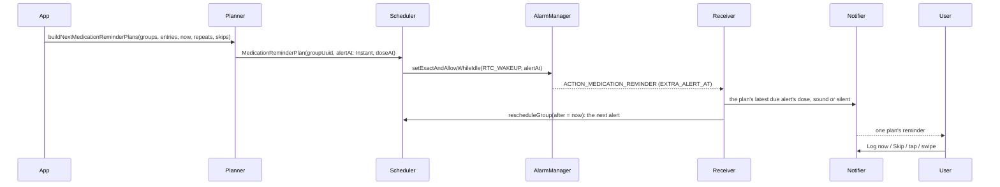

# Reminders

How Featherline turns a medication schedule into dose-reminder
notifications at the right wall-clock time, repeats them while the dose
is unlogged, and keeps that pipeline right across reboots, time zone
changes, and revoked permissions. The whole subsystem lives in
[`reminder/`](../app/src/main/java/com/mkx/hrttracker/reminder). For
where it sits in the layer map, see [architecture.md](architecture.md).
The design is `notes/2026-11-10-reminders-v2.md`; its rules are
model-checked by the `verify-reminders` skill.

## The rules

1. **One notification per plan.** It names that plan's dose due at its
   alert time and nothing from other plans; Log now logs that plan only.
2. **A dose rings a fixed number of times while it is unlogged.** Its
   alerts are instants: the dose's own (its wall time in the current
   zone: a time the clocks skip rings once they have, an hour later; a
   time they repeat rings on its first pass), then *count* repeats *i*
   minutes apart in real time (Settings → Repeat reminders, one setting
   for every plan, default 3 × 15 min; count Off or 1-4, interval 15-60
   min in 5-minute steps, from 15 because Doze holds alarms to about one
   in 15 minutes; a stored or restored interval under 15 reads as 15;
   any other value outside these reads as the default from the store,
   and rejects a backup). The alerts stop at the
   first of: the count, a log of the dose, Skip, or the instant of the
   plan's next dose. A late delivery posts only an alert that is still
   current, less than one hour old, whatever the interval; an older one
   posts nothing, as after a clock change, a boot or the phone being
   off, and the dose shows as missed on Home. An hour because an
   inexact alarm (no exact-alarm access) comes within an hour of its
   time on Android 12 and later, unless battery saver or Doze defers
   it.
   Nothing is stored per alert: each pass works the alerts out from the
   schedule, the log and the clock, and arms one alarm per plan, at its
   next alert. Nothing reads an armed instant back as a wall time.
3. **Sound.** Every alert sounds, repeats included, except that of
   plans alerting at one time only the first to arrive sounds; the rest
   post silently, with no sound and no heads-up. A late post for an
   alert at or before the last one that sounded posts silently too.
   Reposts by the reconcile are silent.
4. **Skip** stops that dose's alerts and dismisses the notification. It
   logs nothing, so Home still shows the dose as missed. Toast:
   "Notifications will stop for this dose."
5. **A swipe** (or Clear all) dismisses the notification, and the alerts
   go on. A toast names the plan's next alert; after Clear all, one toast
   names the earliest next alert of the plans dismissed together.
6. **A tap on the body** opens the app on the dose's row and leaves the
   reminder; it goes when the dose is logged (from the reminder or in the
   app) or skipped, when it is swiped, or once the dose's day is over: at
   the plan's next dose at the same schedule time (tomorrow's, for a daily
   plan), so missed reminders don't pile up.

## Sequence

## Pipeline

### Plan

[`MedicationReminderPlanner.kt`](../app/src/main/java/com/mkx/hrttracker/reminder/MedicationReminderPlanner.kt):

- `reminderAlerts(dosesFrom, entries, repeats, skippedThrough)` — every
  alert of a plan's doses from a time on, in order. A dose rings while
  `missingSlotCounts` says it misses some medication (a dose logged
  early or late, even outside its window, is taken) and it is after the
  plan's skip watermark. Its alerts are the dose time plus k × the
  interval, k = 0..count, before the plan's next dose (`withNextDoseAt`).
- `nextReminderAlert(after, …)` — the first alert strictly after a
  time. An alert at exactly `now` has rung, so arming it again
  would ring a just-tapped reminder again. Startup and the other writers
  pass no time, so the scheduler reads `Instant::now` under its lock;
  only the receiver passes `after`, the instant it received the alarm.
- `latestDueReminderAlert(since, now, …)` — the latest alert from the
  armed one up to now: what a delivery rings for. A late delivery rings
  only that one, not each alert it was late for, and only while it is
  current: `now < alertAt + ALERT_CURRENT_FOR` (one hour). An older
  one rings nothing, so
  a burst of late deliveries posts no stale reminder per plan. A missed
  dose shows as overdue on Home; nothing is logged.
- `buildNextMedicationReminderPlans` — one plan per active group with
  reminders on and medications: an armed alert whose instant has passed
  is armed again as it is (it fires at once; see [Edge
  cases](#edge-cases)), else the next alert.

### Schedule

[`MedicationReminderScheduler.kt`](../app/src/main/java/com/mkx/hrttracker/reminder/MedicationReminderScheduler.kt)
is the single seat for setting and cancelling alarms. Every pass and
delivery runs under `withReminderScheduleLock`.

- `rescheduleAll(now, repostShown)` — full rebuild from Room. Used by
  the capability reconciler, startup, Settings, the editor's archive.
  `repostShown` reposts every reminder on screen, silently, after a
  restore. A pass that starts with the reconcile-owed flag set reposts
  too, under the lock, so a new process's first pass reposts whichever
  of its launches (the first resume's capability reconcile, or
  StartupPreloader) runs first.
- `rescheduleFromHomeSnapshot(snapshot, now)` — the same from an
  already-built `HomeSnapshotRecord`, before the database is warm.
- `rescheduleGroup(groupUuid, after)` — one plan, after a delivery, a
  log, an edit, a Skip.
- `skipThrough(groupUuid, doseAt)` — Skip: moves the plan's watermark
  (never back) and reschedules it, in one hold.
- `claimAlertSound(alertAt)` — the sound rule, with the last sounded
  alert instant kept in memory. A process death between two plans'
  alarms gives two sounds, which is the safe way to fail.

Alarms use `setExactAndAllowWhileIdle` on `RTC_WAKEUP` when
`canScheduleExactAlarms()`, with a fallback to `setAndAllowWhileIdle`
if the call throws `SecurityException`, or directly when exact access
is missing. A plan's alarm intent has the data URI
`hrttracker://medication-reminder/<groupUuid>`, so arming it again
replaces the previous one, and carries the alert's instant in
`EXTRA_ALERT_AT`.

### The schedule store

[`ReminderScheduleStore`](../app/src/main/java/com/mkx/hrttracker/reminder/ReminderScheduleStore.kt)
(`reminder_schedule`, a Preferences DataStore; a corrupt file reads as
empty) holds:

- each armed plan with its alert's **instant** (epoch millis). A key
  with no time, as v1.4.2 stored it, takes any delivery. A missing key
  means delivered, cancelled, or reminders off. A pass reads it to
  cancel orphans and to arm again an alert that passed undelivered;
- each plan's **skip watermark**: the latest dose time you tapped Skip
  on. Alerts consider only doses after it. One value per plan, so it
  never grows past the plans ever skipped; a restore clears them all;
- the reconcile-owed flag.

### A delivery is identified by its instant

The receiver posts only while the plan's stored instant is the alarm's
(`awaitsReminderDelivery`). Comparing local times, as v1.4.2 did, took
an old alarm delivered just after a zone change for the new one when
the two shared a local time: it rang at the wrong moment, and the
dose's ring at its new local time was lost.

### Receive

- [`MedicationReminderReceiver`](../app/src/main/java/com/mkx/hrttracker/reminder/MedicationReminderReceiver.kt)
  — reads the master switch, then in one hold of the lock: checks the
  stored instant, posts the plan's reminder for its latest due alert
  if that alert is under an hour old (reading the switch again just
  before), marks it delivered, and arms
  the next alert. With reminders off it posts nothing.
- [`MedicationReminderActionReceiver`](../app/src/main/java/com/mkx/hrttracker/reminder/MedicationReminderActionReceiver.kt)
  — Log now (`ACTION_MEDICATION_REMINDER_LOG_NOW`), Skip
  (`ACTION_MEDICATION_REMINDER_SKIP`), and the notification's delete
  intent (`ACTION_MEDICATION_REMINDER_DISMISSED`). A v1.4.2 Remind later
  tap or snooze alarm does nothing.
- [`MedicationReminderRescheduleReceiver`](../app/src/main/java/com/mkx/hrttracker/reminder/MedicationReminderRescheduleReceiver.kt)
  — `BOOT_COMPLETED`, `MY_PACKAGE_REPLACED`, `TIME_SET`,
  `TIMEZONE_CHANGED` and `SCHEDULE_EXACT_ALARM_PERMISSION_STATE_CHANGED`,
  all through `ReminderCapabilityReconciler.reconcile(forceReschedule =
  true)`.

### Act

[`MedicationReminderActionHandler.kt`](../app/src/main/java/com/mkx/hrttracker/reminder/MedicationReminderActionHandler.kt):

- `logNow` — logs what the reminder showed (the action carries the
  `(slot, MedicationSignature)` pairs, so an edit since drops out),
  shows a logged or a stock toast, cancels the notification and
  reschedules the plan. It logs an archived or muted plan's dose too:
  the tap is explicit.
- `skip` — in one hold: cancels the notification, moves the watermark,
  reschedules the plan; then the toast.
- `dismissed` — the swipe's toast, from the plan's armed alert: "Next
  reminder: 08:15" today, "Next reminder: Nov 14 · 08:15" another day,
  "Next reminder: Jan 1, 2027 · 08:15" another year (`dateLabelFormatter`
  and the device's 12/24-hour time). No toast with reminders off or
  nothing armed ahead. Clear all sends one delete intent per reminder,
  each its own broadcast, handled one after another: the first opens a
  500 ms window (`NEXT_REMINDER_TOAST_WINDOW_MS`), the others join it,
  and its end shows one toast for the earliest alert. A dismissal within
  2 s of the window's opening that comes after it closed shows none, as
  the Settings version copy (`NEXT_REMINDER_TOAST_THROTTLE_MS`). Both
  live in memory: a process death at worst shows no toast, or one more.

### Notify

[`ReminderNotificationManager.kt`](../app/src/main/java/com/mkx/hrttracker/reminder/ReminderNotificationManager.kt)
owns one channel, `dose_reminders` at `IMPORTANCE_HIGH`, whose name and
description are in the app language. Every string, date and time a
reminder or toast shows is resolved in the app language, also in a
process an alarm woke (`SettingsRepository.appLanguageTag()`). With
Follow system that is the phone's language mapped to a supported one, as
the screens show it, not the application context's own.

A reminder carries the plan name as its text, the dose's date and time
as its subtext, the medications in its expanded text (or only the plan
name with Hide medication details on), Skip and Log now actions, and a
delete intent. Its tag, `medication-reminder/<doseAt>/<hash of its
slots>`, is per plan and dose, so a repeat posts in place, and with no
`setOnlyAlertOnce` it alerts again. A silent post uses `setSilent`. Its
category is `CATEGORY_REMINDER`, so a Do Not Disturb that allows
reminders lets it through.

`reconcileDoseReminderNotifications`, run by every pass, brings the
reminders on screen in line with the plans, one per plan: one whose dose
is gone (logged, moved by an edit, plan archived, deleted or muted) is
cancelled, one whose medications changed is reposted silently in place.
With reminders off, every one goes. Turning Hide medication details on
or off, and a change of the language the app shows (followed in
`HrtTrackerApplication`'s `followAppLanguage`), repost every reminder on
screen silently (`refreshDoseReminderNotifications`); a switch between
Follow system and the language it shows changes nothing, so reposts
nothing. The language changes in Settings, from API 33 in Android's
per-app language setting, and with Follow system when the phone's
changes: `MainActivity` handles `locale` configuration changes itself,
so those arrive only as a configuration change, which
`HrtTrackerApplication.onConfigurationChanged` reads into the app
language (`followAndroidAppLanguageSetting`), with or without an
activity; the screens switch and the reminders are reposted as for one
made in Settings. One made while the app was dead is caught at the next
start: when the first language differs from the one the last run showed
(`SettingsRepository.lastRunAppLanguageTag()`, read when the repository
is built, before this run stores its own; with Follow system it is the
phone's language it resolved to), the channel is re-registered and the
reminders reposted too. A start with nothing changed reposts nothing.
The repository stores the language it starts in once it has read the
last one, so a process an alarm woke after a change reposts once, not at
every start until the app is opened. The choice is known with no
activity on every API level (`appLocales()`, see
[localization](localization.md#language-switching-paths)), so after an
update from v1.4.2, which kept it only in AppCompat's file, the first
process an alarm wakes already posts in it.

Tapping the body opens the app on the dose's row
(`hrttracker://medication-reminder-notification/<tag>`, with
`EXTRA_HIGHLIGHT_SCHEDULED_TARGETS`), as the widget's row tap does. It
has no `setAutoCancel`, so the tap leaves the reminder on screen: on the
lock screen Android asks to unlock first (its own behavior for a content
intent that starts an activity), then the app lock, if on, asks too. The
reminder goes with Log now, Skip, a swipe, or a log in the app, whose
writer's pass (`rescheduleAll` or `rescheduleGroup`) cancels a reminder
whose dose is logged. A missed dose's reminder stays past the plan's next
dose (V4), until the plan's next dose at the same schedule time: then the
next pass cancels it (`doseLifetimeEnded`), the bound v1.4.2's snoozes
had.

### Capability and permissions

- `NotificationPermissions.kt` — `canPostNotifications` and
  `canScheduleExactAlarms`.
- [`ReminderCapabilityReconciler.kt`](../app/src/main/java/com/mkx/hrttracker/reminder/ReminderCapabilityReconciler.kt)
  — re-reads both, publishes them, turns the master switch off when
  notification access is gone, and runs `rescheduleAll`. It skips the
  pass when nothing changed since its last run, unless forced (the
  receivers, a restore). `MainActivity.onResume` calls it. Access that
  comes back leaves reminders off.
- The Settings switch works as the Health Connect weight-sync switch:
  no message up front. Turning it on asks for `POST_NOTIFICATIONS` on API
  33+ (`reminderEnableStep`); granted, reminders turn on. Denied, or
  notifications blocked for the app (also below API 33), Settings shows
  "Enable app notifications in system settings.", which opens the app's
  notification settings, and the switch is disabled while it shows. The
  denial (`AccessDenials`, in memory, as the weight sheet's Health
  Connect denial) lasts the app's process: the message is there each time
  Settings comes back, until notifications are allowed or the app
  restarts. Allowed on the return from the message's trip to Android's
  settings, reminders turn on; allowed any other way, the message goes
  and the switch can be tapped again, but nothing turns on by itself.
  The trip ends at the first pause after the return, and also when the
  page or sheet that showed the message leaves composition after the
  return (a sheet closes without a pause); none starts if the settings
  screen can't be opened (`AccessDenial.openSettings`). The denial itself
  stays. A trip still away survives a recreation of the activity: the
  restored page or sheet sees the return. Known limit: a trip still away
  when a deep link closes the weight sheet stays open, so the sheet's
  next opening counts as its return.
  Exact-alarm access has its own message, as before. Onboarding's
  notification step and a plan editor's switch have their own flows.

## The upgrade from v1.4.2

v1.4.2 had Remind later and merged the reminders of plans that shared
a time. On the first start of a later version (the package replaced, or
the first resume):

1. The capability reconciler reads the old snooze store
   (`medication_reminder_snoozes`), cancels each snooze alarm (their
   PendingIntents used `hrttracker://medication-reminder-snooze/<time>/<hash>`),
   and deletes the store (`LegacySnoozeCleanup.kt`).
2. v1.4.2's reminders on screen, merged ones included, are gone: the
   system cancels a package's notifications when it replaces the
   package (they carried no doses in their extras, so the reconcile
   couldn't have read them anyway). The next alerts post one per plan.
3. A v1.4.2 alarm carries no instant; only a v1.4.2 key, with no time,
   takes it. The channel stays the same.

## Reboot and time-zone reconciliation

Boot and an APK replacement lose every alarm; a time or zone change
moves every alarm's instant. Each goes through the forced capability
reconcile, which re-derives every plan's next alert from the schedule:
"re-derive, don't replay". An alert that passed meanwhile is armed
again and fires at once, and its delivery posts only if the alert is
still current, under an hour old: after a boot hours on, or a
clock set hours forward, nothing posts for doses whose alerts are spent.
The time receivers also refresh `AppTimeSource` and ask Home for a
rebuild.

## Edge cases

- **Exact-alarm permission denied.** Alarms are inexact, so Doze can
  defer them; the reconciler exposes `hasExactAlarmAccess = false` so
  Settings can offer a fix. The repeats are as late as their alarms.
- **Notification permission denied.** Posts are skipped, and the
  reconciler turns the master switch off.
- **A time that passes while the device is off.** The receiver replaces
  the plan's stored alert with the next one after each delivery, so an
  alert still in the past at a pass was never delivered: it is armed
  again, fires at once, and the receiver rings the plan's latest due
  alert if it is under an hour old; else it posts nothing and arms the
  next alert. An alarm in flight when the pass runs is delivered twice; the
  first delivery marks it, so the second posts nothing.
- **Clock moved forward, or a late delivery.** The reminder names the
  latest due alert's dose, so Log now saves the dose that is due; the
  next alarm is set from now. An hour or more past that alert, nothing
  posts: the dose shows as missed on Home and the
  next alert is armed. So a jump of hours posts nothing for doses whose
  alerts are spent, rather than one stale, sounding reminder per plan.
- **The clocks go back or forward.** Alerts are instants, and every
  pass and delivery takes its `now` as an instant from the clock, never
  as a wall time. An hour that repeats: a dose in it has its alert on
  the first pass, so on the second it has passed and rings no more. A
  gap: a dose in it rings once the clocks have skipped, an hour later.
  Repeats are real time, so they stay i minutes apart across a change.
  Known limits:
  - on the spring-forward day, a dose in the gap and the plan's next
    dose under an hour after it (02:30 and 03:00 on Mar 8): the 02:30
    dose doesn't ring, because its moment (03:30) comes after the next
    dose's (03:00). The 03:00 reminder covers it, and Home shows 02:30
    as missed;
  - a dose in the hour first armed on its second pass, as for a plan
    created then, keeps its first-pass instant, so the part of its
    repeats still to come rings in the second pass, early on the clock
    (R10). In New York on Nov 1 2026, a plan created at the second
    01:10 with a 01:45 dose and the default repeats posts at 01:15 and
    01:30 on the clock, labelled 01:45, and nothing at 01:45; with
    repeats Off, nothing rings that day. It is one hour a year, and a
    fix would need stored state;
  - setting the clock back by hand, or moving to a zone further west,
    repeats wall times the zone rules don't, so an alert that rang can
    ring again (R11). A sounded alert later than the clock is then
    forgotten, so an alert that comes before it sounds rather than
    posting silently. If nothing else sounds first, the alert that had
    sounded posts silently when the clock reaches its time again: it
    has sounded once.
- **Repeats in Doze.** The platform limits how often an app's
  `setExactAndAllowWhileIdle` alarms go off: about once a minute in
  normal use, and in low-power idle modes much less often, such as
  once per 15 minutes. So the shortest interval is 15 minutes; even so,
  a repeat on an idle phone can arrive late, and a late delivery rings
  only the latest due alert: two repeats can collapse into one ring. An
  alarm that battery saver or Doze defers an hour or more past a dose's
  last alert posts nothing (ponytail comment at `ALERT_CURRENT_FOR`).
- **A failed delivery.** `scheduleGroupReminder` does its reads before
  it cancels, so a failed reschedule leaves the plan's alarm and key as
  they were; the delivered plan's own alarm was the one consumed, so it
  has none until the next full pass (app start, boot, time change). A
  pass stores its plans before it arms them.
